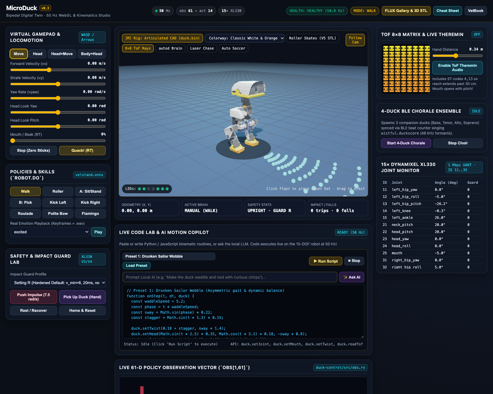

# 🦆 MicroDuck Digital Twin — 50 Hz Browser & Python Simulator

[](LICENSE)
[](src/)
[](web/)

An interactive **50 Hz Digital Twin, Safety Verification Suite, and WebGL 3D Simulator** for the 15-DOF bipedal **MicroDuck / XGO-Duck** robot platform (14 policy-driven Dynamixel XL330-M288-T joints + 1 independent beak/mouth actuator).

> **💡 Why I Built This (A Companion Sandbox, Not a Replacement):**  
> I ordered a physical **MicroDuck** and wanted an interactive environment while waiting for it to arrive — a place to understand its 15-DOF kinematics, brainstorm new behaviors, prototype software features, and experiment with hardware/firmware upgrades (like VL53L5CX ToF Theremin synthesis, 4-duck BLE Chorale sync, and Impact Guard tuning). **This simulator is a companion ideation & testing sandbox and is in no way meant to replace the physical MicroDuck robot!**



> **Clean-Room Zero-Redistribution Architecture:**  
> This repository contains **only original simulator code, kinematic/safety models, and deterministic unit tests**. It does **not** redistribute upstream source code, third-party STL/CAD files, or pre-trained ONNX/WAV binaries. Instead, a one-command bootstrap script ([`scripts/fetch_upstream_assets.sh`](scripts/fetch_upstream_assets.sh)) clones the official upstream repositories directly on your machine and builds the local runtime asset bundle.

---

## ✨ Key Capabilities

1. **Articulated 15-DOF SE(3) CAD Rig, 36° Creased Normals & Inline Roller-Blade Assembly**
   - Real-time forward kinematics across all 15 robot bodies (`left/right hip_yaw, hip_roll, hip_pitch, knee, ankle`, `neck_pitch`, `head_pitch, head_yaw, head_roll`, and `mouth`) with **36° (`Math.PI / 5`) creased vertex normal smoothing** and automatic hot-upgrade to the 38-mesh (`104,024` triangle) CAD `microduck.glb` geometry.
   - **16-Slot PBR Material Table** across all 5 hardware shell colorways (*Cream / Classic White & Orange*, *Sky / Light Blue & Orange*, *Lavender / Purple & Yellow*, *Graphite / Charcoal & Yellow*, and *Raw CAD*), plus RANSAC-fitted physical jaw hinge pivot (`[0, 0.00004, 0.0075]`) and 4-point studio lighting over an antialiased GLSL Tron grid.
   - **Authentic Inline Roller-Blade Assembly & Skating Physics:** Swaps walking soles for the 2-wheel inline roller-blade assembly (`ankle_l_v1.stl`, `ankle_r_v1.stl`, `roller_blade.stl`, and front/rear `rim.stl` + `tire.stl` wheels on passive Z-axis hinges `passive_LF/LR/RF/RR_wheel`) with V-push skating stride (`RVEL_FWD = 0.60 m/s`), CoM carve lean, and **Crouch Glide (`roller_crouch`)** skill (`BEST_roller.onnx` & `BEST_roller_crouch.onnx`).
   - Interactive **Subsystem Inspector HUD Bar** and glassmorphic hover tooltips explaining every control, sensor, policy, and safety subsystem.

2. **50 Hz Closed-Loop Code Lab, Sim-to-Real Gap Injector & AI Controller Synthesizer**
   - Live in-browser 50 Hz closed-loop execution engine (`⌘/Ctrl + Enter` hot-swap): write JavaScript (`function onStep(t, dt, duck)`) or multi-branch Python (`def on_step(t, dt, duck):` via an indentation-aware transpiler) to test feedback controllers in real time.
   - Ground-truth closed-loop `duck` API:
     - **Sensors & State:** `duck.readImu()`, `duck.readTarget()` (pose, SE(2) laser dot & soccer ball bearing/distance), `duck.readTof()`, `duck.readJoints()`, `duck.readObs61()`.
     - **Actuation & Recovery:** `duck.setJointOffset(name, deltaRad)`, `duck.setJoint(name, absRad)`, `duck.setTwist(vx, vyaw, vy)`, `duck.setHead(yaw, pitch, roll)`, `duck.setMouth(ratio)`, `duck.setMode('walk'|'roller')`, `duck.doSkill(name)`, `duck.recover()`, `duck.playQuack()`, `duck.applyImpulse(rad_s)`.
     - **Live Telemetry & Assertions:** `duck.watch(key, val)` (or `return { key: val }`) and `duck.assert(cond, label)` streaming into the **50 Hz Hardware Contract & Watch Strip** (per-tick execution budget in ms, range/NaN/slew clamp counters, and live variable pills).
   - **Sim-to-Real Reality-Gap Injector:** Toggle live between **Ideal (`0ms`)**, **Nominal (`+20ms` 1-tick IMU delay, $\sigma = 0.02\text{ rad}$ Gaussian noise)**, and **Harsh (`+40ms` 2-tick delay, $\sigma = 0.055\text{ rad}$, XL330 $8.5\text{ rad/s}$ servo slew-rate cap)**.
   - **5 Built-in Closed-Loop Controller Presets:**
     1. *Closed-Loop IMU PD Balance & Push Reflex* (`pd_reflex`)
     2. *SE(2) Laser Visual Servoing* (`laser_servo`)
     3. *Autonomous Soccer Striker FSM* (`soccer_fsm`)
     4. *VL53L5CX ToF Repulsion & Theremin* (`tof_beatbox`)
     5. *Python: Figure-8 Roller Skate CPG Carver* (`python_style`)
   - **AI Controller Synthesizer:** Queries local Ollama (`qwen3:30b-a3b`) when available, with an instant offline intent-aware compositional controller synthesizer fallback.

3. **50 Hz Control Loop (`dt = 0.02 s`) & 61-D Observation Inspector**
   - Faithfully models the 61-dimensional policy observation vector (`gyro[3]`, `gravity[3]`, `joint_pos_err[14]`, `joint_vel[14]`, `prev_action[14]`, `cmd_twist[3]`, `cmd_head[4]`, `pad[2]`, `cmd_body[3]`, `pad[1]`) while excluding beak actuator index `9` (`mouth`) from closed-loop locomotion feedback.
   - Live browser **ONNX Runtime Web** policy inference (`velstand.onnx`, `pickup_detector.onnx`, `pet_detect.onnx`) with a deterministic phase-locked analytical CPG fallback when running offline.

4. **Hardware Safety & Impact Guard Failure Laboratory**
   - **Impact Guard Stress-Test:** Compare factory **Level `5`** (where an $8.2\text{ rad/s}$ ground-contact spike trips a false-positive motor stall and collapses the stance leg) against hardened **Setting `R`** ($12.0\text{ rad/s}$ threshold survival).
   - **63-D Pickup Detector & `PAUSE_POSE` Ramp:** Simulates the $630\text{ D}$ ($10 \times 63$) sliding window pickup classifier and $300\text{ ms}$ smooth leg-tuck ramp.
   - **Safety Invariants:** $500\text{ ms}$ deadman command timeout, $[-\pi, +\pi]\text{ rad}$ target clamping, non-finite (`NaN`/`Inf`) frame rejection, and $200\text{ ms}$ fall-recovery debounce (`GAIN_NORMAL` $\to$ `GAIN_LIMP`).

5. **Multi-Sensor & Behavior Emulation**
   - **VL53L5CX $8\times 8$ ToF Depth Matrix & Theremin:** Interactive hand-distance slider and $8\times 8$ status/range grid with real-time WebAudio Theremin pitch + beak opening modulation.
   - **Autonomous Brains:** `autod` obstacle avoidance, HSV `laser-chase` pursuit, `soccer` ball approach & kick FSM, 13 keyframed emotions, and 4-duck synchronized BLE Chorale (`wistful.duckscore`).

6. **5 Deep Pre-Hardware Subsystems (Clean-Room Referenced from `pollen-robotics/microduck`)**
   - **Pillar 1 — `ALPHA16` 16-Point Sole Contact Odometry (`odometry/src/lib.rs` & `anchors.rs`):** Models the exact $4\times 4$ ($16\text{-point}$ per sole = $32$ total) contact anchor switching at `SWITCH_MARGIN = -0.010 m` after `SWITCH_CONFIRM_TICKS = 2` ($40\text{ ms}$) with continuous `reproject` handoff and live drift comparison ($\text{mm}$) against legacy 4-corner `V15` (`duck.readOdometry()`).
   - **Pillar 2 — `RemoteIo` TCP JSON Simulator Bridge (`duck-control/src/sim.rs`, `PROTOCOL = 1`):** Clean-room TCP server ([`src/remote_io_bridge.py`](src/remote_io_bridge.py)) with `TCP_NODELAY = 1`, version handshake, and stateless per-tick reconnect (`hello`, `read`, `write`, `gain`, `torque`, `slow`) so developers can run the actual upstream Rust `robotd --sim` daemon directly against this Digital Twin before physical hardware arrives.
   - **Pillar 3 — XL330-M288-T Register Bus Physics (`duck-control/src/bus.rs` & `Rhoban/bam`):** Models Fast Sync Read (`0x8A`) contiguous 12-byte register block `124..136` (`0.229 rpm/count` velocity quantization, `4096 counts/rev` encoder quantization, `±885` PWM, current $\text{mA}$), $1\text{ Hz}$ `slow_sensors` block `144..146` (`0.1 V` 2S Li-Ion voltage sag $8.4\text{ V} \to 6.8\text{ V}$, $1^{\circ}\text{C}$ Joule coil heating + $70^{\circ}\text{C}$ thermal derating), and the $25\text{-tick}$ (`0.5 s`) `StaleImuTracker` (`duck.readBusSlow()`).
   - **Pillar 4 — `maploc` Stop-and-Vote ToF Micro-Mapper & `pet-detect` Log-Mel Classifier (`maploc/src/lib.rs` & `pet-detect/src/lib.rs`):** Votes $8\times 8$ VL53L5CX ToF scans into rigid keyframes only during standing stops (`StopAndVoteMapper`), and computes the pinned $16\text{ kHz}$ $40\text{-band} \times 100\text{-frame}$ ($16,240\text{-sample}$) log-mel spectrogram with `SoundSentry` silence gating and `0.95 / 0.85` hysteresis (`duck.readPetting()`).
   - **Pillar 5 — `pad-imu` 6-Axis Complementary Filter, `12 °/s` Clone Bias Calibrator & Dead-Radio Auditor (`pad-imu/src/lib.rs` & `padd/src/tap.rs`):** Models the $0.5\text{ s}$ stillness-window gyro bias calibrator (`STILL_SPREAD_DPS = 3.0 °/s`, `GRAVITY_BAND = 0.85..=1.15 g`) and detects the `SYN_DROPPED` / stale-evdev dead-radio trap where `padd` keeps `robotd`'s $250\text{ ms}$ deadman alive (`duck.readPadImu()`).

---

## 🔗 Referenced Upstream Repositories & Credits

This project builds upon and references the open hardware and software ecosystem created by **Pollen Robotics**, **Luwu Intelligence Technology (XGO)**, **MuJoCo Lab**, and **Rhoban**:

| Upstream Project | Repository / Resource | Role & How It Is Referenced | Upstream License |
| :--- | :--- | :--- | :--- |
| **Pollen Robotics — MicroDuck Software Stack** | [`pollen-robotics/microduck`](https://github.com/pollen-robotics/microduck) | Reference specification for the 15-DOF joint order, 61-D observation vector, 63-D pickup feature layout, MJCF kinematics, and emotion keyframes fetched by [`src/extract_ground_truth.py`](src/extract_ground_truth.py). | Apache-2.0 |
| **Pollen Robotics — MicroDuck Web Simulator** | [`pollen-robotics/microduck-simulator`](https://huggingface.co/spaces/pollen-robotics/microduck-simulator) | Reference for 36° creased normal smoothing, 16-slot PBR colorway palettes, RANSAC jaw pivot, antialiased GLSL floor shader, and the inline roller-blade MJCF kinematics (`kinematics_rollers.json`) & policies (`BEST_roller.onnx`, `BEST_roller_crouch.onnx`) fetched by [`scripts/fetch_upstream_assets.sh`](scripts/fetch_upstream_assets.sh). | Apache-2.0 |
| **Pollen Robotics — MicroDuck RL & Policies** | [`pollen-robotics/microduck_rl`](https://github.com/pollen-robotics/microduck_rl) & [`pollen-robotics/microduck-policies`](https://huggingface.co/pollen-robotics/microduck-policies) | Pre-trained ONNX locomotion policies (`velstand`, `walk`, `stand`, `roller`) downloaded on demand into `web/assets/policies/`. | Apache-2.0 |
| **Luwu Dynamics (XGO) — XGO-Duck Hardware** | [`LuwuDynamics/xgoduck_hardware`](https://github.com/LuwuDynamics/xgoduck_hardware) | Official V2 Standard (47 STLs) and V5 Audio-Video (50 STLs) 3D-printable shell & roller-wheel CAD files cataloged locally by [`src/build_xgoduck_stl_assets.py`](src/build_xgoduck_stl_assets.py). | Personal / Educational (`LICENSING.md`) |
| **MuJoCo Lab — `mjlab`** | [`mujocolab/mjlab`](https://github.com/mujocolab/mjlab) | Underlying reinforcement learning training framework used by upstream MicroDuck policies. | Apache-2.0 |
| **Rhoban — `bam`** | [`Rhoban/bam`](https://github.com/Rhoban/bam) | Better Actuator Model (XL330 friction, armature inertia, and torque-speed Identification) referenced for joint dynamics. | MIT |

---

## 🚀 Quickstart

### 1. Clone & Install Python Dependencies

```bash
git clone https://github.com/mrojek-com/microduck-digital-twin.git
cd microduck-digital-twin
python3 -m pip install numpy trimesh pytest
```

### 2. Fetch Official Upstream Assets (Optional but Recommended)

To populate `web/assets/` with the real articulated CAD meshes, XGO-Duck STL shells, emotion keyframes, and ONNX policies directly from the official upstream repositories:

```bash
bash scripts/fetch_upstream_assets.sh
```

*(Note: Even before running `fetch_upstream_assets.sh`, the Python physics/kinematics test suite and procedural 3D fallback work out of the box.)*

### 3. Launch the Interactive WebGL Digital Twin

```bash
python3 -m http.server 8778 --bind 127.0.0.1 --directory web
```

Then open **`http://127.0.0.1:8778`** in Chrome, Firefox, or Safari.

### 4. Run the Verification Test Suite

```bash
bash run_tests.sh
```

---

## 📁 Repository Structure

```text
.
├── LICENSE                          # Apache-2.0 license + upstream attribution notice
├── README.md                        # Project documentation & upstream references
├── .gitignore                       # Excludes secrets, PII, and upstream clones/binaries
├── run_tests.sh                     # Deterministic pytest runner
├── scripts/
│   └── fetch_upstream_assets.sh     # Clones upstream repos & builds local web/assets/
├── src/
│   ├── models.py                    # 15-DOF joint definitions, actuator constants & limits
│   ├── kinematics_obs.py            # SE(3) forward kinematics, 61-D obs & 63-D pickup features
│   ├── prehardware_subsystems.py    # ALPHA16 odometry, XL330 0x8A registers, maploc, pet-detect, pad-imu
│   ├── remote_io_bridge.py          # Drop-in RemoteIo TCP JSON server (duck-control/src/sim.rs PROTOCOL=1)
│   ├── sim_engine.py                # 50 Hz physics engine, safety guards & Impact Guard model
│   ├── extract_ground_truth.py      # Extracts CAD rig, MJCF, emotions & ONNX from upstream
│   └── build_xgoduck_stl_assets.py  # Catalogs & converts XGO-Duck V2/V5 STL hardware shells
├── tests/
│   └── test_microduck_sim.py        # 15 deterministic unit, closed-loop, RemoteIo & pre-hardware tests
├── docs/
│   └── CHEATSHEET_MASTER_GUIDE.md   # Deep architectural & hardware reference guide
└── web/
    ├── index.html                   # 3-column dark-mode telemetry & WebGL UI
    ├── styles.css                   # Responsive styling & non-overlapping viewport HUD
    └── simulator.js                 # 50 Hz Three.js + ONNX Runtime Web + WebAudio engine
```

---

## 📜 License & Hardware Usage Notice

- **Simulator Source Code (`src/`, `web/`, `tests/`, `scripts/`):** Released under the **Apache License 2.0** (see [`LICENSE`](LICENSE)).
- **Upstream Software (`pollen-robotics/microduck`, `pollen-robotics/microduck_rl`):** Licensed by Pollen Robotics under the **Apache License 2.0**.
- **Upstream Hardware CAD/STL Assets (`LuwuDynamics/xgoduck_hardware`):** Fetched locally via `scripts/fetch_upstream_assets.sh` for personal and educational use in accordance with Luwu Intelligence Technology's [`LICENSING.md`](https://github.com/LuwuDynamics/xgoduck_hardware/blob/main/LICENSING.md). Commercial use of the physical hardware designs requires separate authorization from the upstream hardware maintainer.
